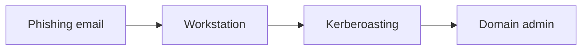

# Shokunin showcase

This note uses every kind of formatting a vault supports, so you can see how your Shokunin themes render it. Flip between the two looks with `daynight light` and `daynight dark`, and compare reading view with live preview using <kbd>Cmd</kbd>+<kbd>E</kbd>.

## Headings

Each level steps down in size. The top level sits on a rule, and the short stroke where the rule starts takes the heading's own colour.

### Third level

#### Fourth level

##### Fifth level

###### Sixth level

## Text

Body text uses your Obsidian font and size. You can write **bold**, *italic*, ~~struck through~~, ==highlighted== and `inline code`.

Links go to a heading in this note, like [[#Tables]], or out to the web, like [the shokunin repo](https://github.com/akhara-io/shokunin). A link to a note that doesn't exist yet, like [[Retest plan]], stays muted until you create it. Tags look like #engagement and #htb.

Keys show as key caps: <kbd>Cmd</kbd>+<kbd>P</kbd> finds files, and <kbd>Ctrl</kbd>+<kbd>Space</kbd> is the tmux prefix.

Footnotes collect at the bottom of the note.[^scope]

[^scope]: The client confirmed scope in writing on the kick-off call.

## Lists and tasks

Sub-points hang off a line from their parent and branch into each bullet, so you can follow the structure at a glance. Switch it off with Obsidian's **Indentation guides** setting.

- Recon
  - Full TCP port scan
    - Top 1,000 ports first
    - Then all 65,535
  - Web content discovery
  - Virtual host fuzzing
- Initial access
  - Password spraying against the VPN portal
- Privilege escalation

1. Confirm scope with the client
   - Staging is in scope
   - Production is not
2. Run the scans
3. Write up the findings

- [x] Kick-off call
- [x] Full port scan of 10.10.11.42
- [ ] Retest the SQL injection
  - [x] Reproduce it on staging
  - [ ] Confirm the fix with the developer
- [ ] Send the draft report

## Code

```bash
nmap -sC -sV -p- --min-rate 5000 -oA scans/full 10.10.11.42
```

```python
import requests

r = requests.post("http://10.10.11.42/login", data={"user": "admin' -- -", "pass": "x"})
print(r.status_code, len(r.text))
```

```powershell
Get-ADUser -Filter * -Properties ServicePrincipalName |
  Where-Object { $_.ServicePrincipalName } |
  Select-Object SamAccountName, ServicePrincipalName
```

## Quotes and callouts

> The client confirmed the staging server is in scope. Production is not.

> [!note]
> Each callout takes the colour of its type.

> [!tip] Faster scans
> Raise `--min-rate` on lab networks, and keep it low on client networks.

> [!success] Fixed on retest
> The login form now uses parameterised queries.

> [!warning]
> The VPN drops after 30 minutes idle.

> [!danger] Critical
> Domain admin credentials were readable by every user on a file share.

> [!bug]- Screenshots over RDP come out blank
> This callout starts folded. Click its title to open it.

## Tables

| Severity | Finding                        | Host        | Status   |
| -------- | ------------------------------ | ----------- | -------- |
| Critical | SQL injection in login form    | 10.10.11.42 | Fixed    |
| High     | SMB signing not required       | 10.10.11.17 | Open     |
| Medium   | Outdated TLS configuration     | 10.10.11.42 | Open     |
| Low      | Server version in HTTP headers | 10.10.11.42 | Accepted |

## Diagram



---

The line above is a horizontal rule.
